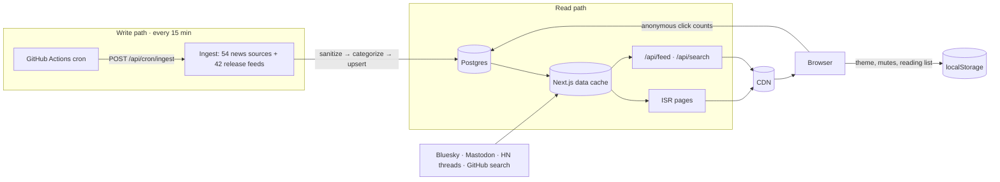

# DevPulse

[](https://github.com/Masad791/devpulse/actions/workflows/ci.yml)
[](LICENSE)

Open-source tech news for builders: **AI & ML, system design, DevOps, cloud, web, data, security, languages, mobile, open source and career** — plus what engineers are saying on Bluesky and Mastodon, trending GitHub repos, releases, and issues you can contribute to. Built entirely on free public APIs.

**Live:** https://devpulse-five-red.vercel.app

## Features

**Read**
- **13 topics** from 55 sources: Hacker News, Dev.to, Lobsters, Hugging Face Papers and 50 engineering blogs (Netflix, Meta, Stripe, Cloudflare, ByteByteGo, AWS, Kubernetes, Rust, Go, Krebs, Martin Fowler…).
- **Story clustering**: the same story on HN, Lobsters and a blog becomes one entry — "also on Lobsters", with comments counted across all of them.
- **Search** every story ever collected (Postgres full-text: `postgres vector`, `"system design"`, `rust -async`), from the search page or **Ctrl+K** anywhere.
- **Buzz**: posts from 20 well-known engineers on Bluesky + trending tech posts on Mastodon, live ("N new posts").
- **AI Skills** (`/skills`): trending agent skills by installs (skills.sh), new skill repos on GitHub, and skill news, with its own RSS feed.
- **Release radar**: latest stable release of 42 tools — Next.js, React, Node, Rust, Go, Kubernetes, Claude Code, Ollama…
- **Trend radar**: which technologies are being written about more or less this week, with 28-day sparklines.
- **Weekly digest**: top stories per topic, what's rising, what shipped — as a page and an RSS feed (a newsletter without email).
- **Repos** (trending by category: AI skills, MCP servers, self-hosted…), **Contribute** (good first issues by label/language), **Discussions** (the most-commented threads).

**Make it yours** — no account, everything stays in your browser
- 9 themes, any accent color, list or card layout, compact mode, sans or mono font.
- A personal **For you** feed, **mute** keywords or sources, and a **reading list**.
- Keyboard: `j`/`k` move, `o` open, `c` comments, `b` save, `/` search, `?` help. Opened stories are dimmed.

**Take it with you**
- RSS: `/rss.xml`, per topic `/<topic>/rss.xml`, and `/digest/rss.xml`.
- Installable app (PWA), share previews with today's headlines, and a [new-tab browser extension](extension/).
- Free JSON API with open CORS.

## How it works



- **Write path vs read path.** A scheduled job (`/api/cron/ingest`, called every 15 min by [GitHub Actions](.github/workflows/ingest.yml) — free, where Vercel's free cron is once a day) fetches all sources and upserts them into Postgres. Pages never call the 54 upstream APIs; they read the database. Slow or flaky sources (some release feeds take 30 s) only ever slow the background job. A Postgres advisory lock stops two runs overlapping.
- **The database is optional.** Without `DATABASE_URL` the site fetches sources live, exactly as before — contributors need zero setup. History, search, trends, click counts and rate limiting light up when a DB is configured.
- **Pipeline** (`src/lib/pipeline.ts`) is pure and unit-tested: link sanitizing (only `http(s)` gets in), keyword topics, story clustering, ranking = per-source popularity percentile × 24h half-life × same-source penalty.
- **Caching.** Every page except Search, Contribute and Status is ISR — static HTML on the CDN, rebuilt in the background; filters live in the path (`/repos/mcp/month/python`) so each view is cacheable. After each ingest, `revalidateTag` marks data stale and visitors get the old page instantly while the new one renders.
- **Privacy.** No cookies, no accounts. We count clicks per story per day (no user, no IP); rate limiting keys on a salted daily hash of the IP, never the IP itself. Vercel Web Analytics is cookieless and aggregate-only.
- **Trend math.** Change is measured as *share* of mentions (term / all stories that week), not raw counts, so a week with more stories doesn't make everything "rise"; no percentage is shown under a 3-mention baseline.
- **Themes & mutes** are applied by an inline script before first paint (CSS variables + `data-*` attributes + an injected mute stylesheet), so static pages stay static with no flash.

## Public API

```
GET /api/feed?topic=ai,devops&page=1&limit=30
GET /api/search?q=postgres+vector
GET /api/buzz
GET /api/health            # 200 healthy / 503 stale — for uptime monitors
```

`topic`: comma-separated, any of `ai system-design devops cloud web data security languages mobile open-source career engineering`. `page`: 1–10. `limit`: 1–100. Search is limited to 30 requests/min per visitor.

## Run locally

Requires Node.js 20.9+. Docker is optional (only for the database).

```bash
npm install
npm run dev            # http://localhost:3000 — works right away, fetching sources live
npm test
```

With the database (history, search, trends, clicks):

```bash
cp .env.example .env.local   # then set CRON_SECRET to any long random string
npm run db:up                # Postgres 17 in Docker on port 54329
npm run db:migrate           # create tables (safe to re-run)
npm run dev                  # in one terminal…
npm run ingest               # …and collect stories in another
```

## Deploy

1. **Database**: create a free Postgres on [Neon](https://neon.tech) (or via Vercel → Storage), copy its **pooled** connection string, and run `DATABASE_URL=… npm run db:migrate` once.
2. **Vercel** → Project → Settings → Environment Variables: `DATABASE_URL`, `CRON_SECRET` (random string), `GITHUB_TOKEN` (fine-grained, "Public repositories (read-only)"). Redeploy.
3. **GitHub** → repo Settings → Secrets and variables → Actions: secret `CRON_SECRET` (same value) and variable `SITE_URL` (your site URL). The Ingest workflow then runs every 15 minutes; trigger it once by hand from the Actions tab.
4. Optional: turn on **OIDC Federation** (Vercel → Project → Settings → Security) to fill "Trending skills" on `/skills`. There is no key to manage: the ingest job reads the token Vercel adds to each request. The rest of `/skills` works without it.
5. Optional: enable Web Analytics and Speed Insights in the Vercel dashboard; point an uptime monitor at `/api/health`.

Want your own copy? These buttons fork this repo into your account and deploy it:

[](https://vercel.com/new/clone?repository-url=https://github.com/Masad791/devpulse&env=GITHUB_TOKEN&envDescription=Optional%20read-only%20GitHub%20token%20for%20higher%20search%20rate%20limits)
[](https://app.netlify.com/start/deploy?repository=https://github.com/Masad791/devpulse)

## Contributing

Adding a feed, an engineer, a repo category, a tracked technology, a keyword or a theme is usually one line — see [CONTRIBUTING.md](CONTRIBUTING.md). Security reports: see [SECURITY.md](SECURITY.md).

## Stack

Next.js 16 (App Router, ISR) · TypeScript · Tailwind CSS 4 · Postgres (`postgres.js`) · Vitest · GitHub Actions · Vercel. MIT licensed.
